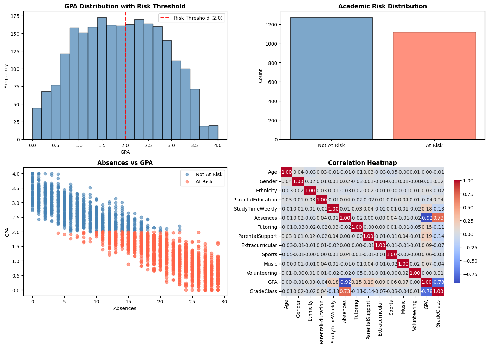

# Explainable AI for Academic Risk Prediction

A student academic-risk research project with a model-training workflow, explainability artifacts, and a Flask web interface for interactive risk predictions.

## Project at a glance

- **Training and analysis:** `main.py` trains and compares Logistic Regression, Random Forest, and XGBoost models using the student performance dataset.
- **Web application:** `app.py` provides a login-protected dashboard and risk predictions using the saved XGBoost model.
- **Explainability and research materials:** EDA and SHAP figures, project synopsis, and presentation are grouped under `assets/` and `docs/`.

## Repository structure

```text
.
├── app.py                         # Flask web application and Vercel entry point
├── main.py                        # Model training and analysis
├── requirements.txt               # Web application dependencies
├── requirements-research.txt      # Additional training and analysis dependencies
├── .python-version                # Vercel Python runtime version
├── data/
│   └── Student_performance_data _.csv
├── models/
│   ├── academic_risk_xgboost.json # Compact tree model used by the web app
│   └── academic_risk_xgboost.pkl  # Full model artifact for Python research
├── templates/                     # Flask HTML templates
├── static/                        # CSS and JavaScript assets
├── assets/
│   └── figures/                   # EDA and SHAP visualizations
└── docs/
    ├── BTP2CSE114_synopsis.pdf
    ├── QUICK_START.md
    ├── START_HERE.md
    └── presentation/
        └── minor_ppt.pptx
```

## Run locally

Use Python 3.12 and create a virtual environment:

```bash
python -m venv .venv
.venv\Scripts\activate
pip install -r requirements.txt
python app.py
```

Open `http://localhost:5000` and sign in with a demo account:

| Username | Password |
| --- | --- |
| `admin` | `admin123` |
| `educator` | `educator@123` |
| `counselor` | `counselor@123` |

These credentials are for demonstration only. Set a unique `FLASK_SECRET_KEY` in the environment before deploying, and replace the in-code demo user list before using this application with real users or student data.

## Train the model

Install the research dependencies and run the training script from the repository root:

```bash
pip install -r requirements-research.txt
python main.py
```

The script reads `data/Student_performance_data _.csv` and saves the trained XGBoost model in two formats: a compact JSON tree model for the web app and a pickle artifact for Python research.

## Deploy to Vercel

The repository is configured for Vercel’s Python 3.12 runtime. The web app uses the compact JSON model and Python’s standard library for inference, keeping the serverless bundle small. Import the GitHub repository as a new Vercel project, keep the project root at the repository root, and add `FLASK_SECRET_KEY` as a Production environment variable before deploying. Vercel detects the Flask application in `app.py`.

## Research materials

- [Project synopsis](docs/BTP2CSE114_synopsis.pdf)
- [Presentation](docs/presentation/minor_ppt.pptx)
- [Quick start guide](docs/QUICK_START.md)
- [Project guide](docs/START_HERE.md)

### Exploratory analysis



Additional SHAP plots are available in [`assets/figures/`](assets/figures/).
